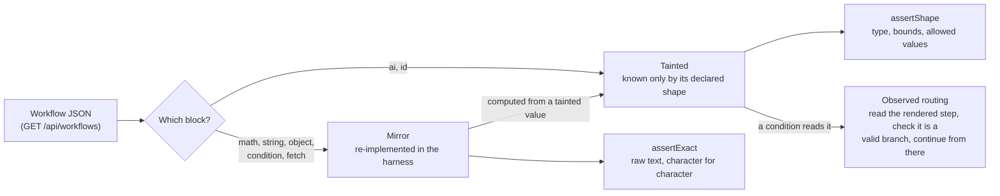

# ai-workflow-testing

[](https://github.com/hassanautomates/ai-workflow-testing/actions/workflows/ci.yml)

Testing workflows that contain AI steps: mirror what's deterministic and assert it exactly; taint
what a model produces and never assert it verbatim.

The approach comes from my work testing an AI-assisted no-code workflow product; this repo is a
from-scratch demo of it that anyone can run.

**Across 20 random model seeds, this suite passed all 20 runs; a fixture-based baseline failed all 20. All five injected engine bugs were caught.** ([details](#results))

## The problem

Products increasingly mix deterministic logic with model output in the same workflow. Fixture-based
suites either fall behind, because new workflows ship faster than anyone writes tests for them, or
go flaky, because model output changes from run to run. This repo shows a third option, end to end.

## The approach

The app under test (`app/`) runs workflows defined as JSON: forms, maths, string and object
operations, conditions, fetches from a mock API, a simulated model (`ai`) and generated IDs (`id`).
The harness (`harness/`) never imports app code. It reads the published workflows from
`GET /api/workflows` and generates one Playwright test per workflow per input case, so a new
workflow is covered without anyone writing a test for it.



- **Mirror.** The harness replays each workflow's deterministic blocks itself, from the JSON
  alone, and predicts every value on every screen. Those values are compared exactly, against
  the raw text the page renders.
- **Taint.** The harness does not re-implement `ai` or `id`. Their outputs are tainted, and so is
  anything computed from them, field by field: one model-written field in an object, or one
  model-written cell in a table, taints that field or cell and nothing else. Tainted values are
  checked against the output contract declared on the block in the workflow JSON (type, required,
  length and range bounds, allowed values), never against exact text. Calling `assertExact` on a
  tainted value is a harness error.
- **Observed routing.** When a condition reads a tainted value, the harness can't predict the
  branch. It reads which step the app rendered, checks that it is one of the branches the workflow
  allows, and keeps mirroring from there. Inside each branch the model value is narrowed by what the
  branch implies, so a later shape check catches the app taking the wrong branch, not just an
  invalid one.
- **Coverage manifest.** Every case writes `reports/manifest/<workflow>/<case>.json`: the seed, every
  element driven, every assertion (exact or shape) and every gap, meaning anything on screen that
  was not asserted, with the reason. `reports/manifest/summary.md` totals them per workflow.
- **Reproducible variance.** `AI_SEED` seeds the simulated model and generated IDs; it is random
  when unset. Every test prints the seed it ran with, and rerunning with that seed reproduces the
  run exactly.

## Quickstart

Requires Node 22+.

```sh
npm ci
npx playwright install chromium
npm test
```

`npm run dev` starts the app on its own. `npm run prove` produces the results below.

## Results

Quoted from [`docs/prove.md`](docs/prove.md), generated by `npm run prove` in
[this CI run](https://github.com/hassanautomates/ai-workflow-testing/actions/runs/42693351952) on
commit `fbbbfc0b1ecf9515080c76654f074fdd6158a73b`, Node v22.23.4, with N = 20 runs per suite.

**Taint-aware versus naive.** (a) is this harness, run with a different random `AI_SEED` each time.
(b) is a naive baseline on the same seeds: it behaves like a fixture-based suite, recording what one
run displayed and then asserting every value exactly, including model output and the route of
model-driven branches.

| Suite              | Runs passed | Tests run | Tests failed |
| ------------------ | ----------- | --------- | ------------ |
| (a) taint-aware    | 20 / 20     | 400       | 0            |
| (b) naive baseline | 0 / 20      | 240       | 98           |

Where a condition read model output, the app took each branch in these proportions, and the
optional due date was present or absent as shown; the taint-aware suite passed either way.

| Where                                       | Branch        | Taken   |
| ------------------------------------------- | ------------- | ------- |
| ticket-triage › duplicate charge › screen 2 | `step:review` | 18 / 20 |
| ticket-triage › duplicate charge › screen 2 | `step:routed` | 2 / 20  |

| Field                                                                          | Present | Absent |
| ------------------------------------------------------------------------------ | ------- | ------ |
| `invoice-extraction › paper supplier invoice › [data-field="invoice.dueDate"]` | 12      | 8      |

**Injected bugs.** Each `ENGINE_BUG` switches one deliberate defect into the engine. Every one was
caught by at least one test.

| ENGINE_BUG            | What goes wrong                                                                                            | Caught by       |
| --------------------- | ---------------------------------------------------------------------------------------------------------- | --------------- |
| `math-off-by-one`     | Every math result comes out 1 too high.                                                                    | 4 failing tests |
| `wrong-branch`        | Every condition takes the opposite branch.                                                                 | 4 failing tests |
| `drop-field`          | object pick silently drops the last field it was asked for.                                                | 3 failing tests |
| `ai-overwrites-field` | The model's first answer field is also written over the input it read, clobbering fetched or entered data. | 2 failing tests |
| `round-toward-zero`   | math rounds by truncating instead of half away from zero, so 4.947525 shows as 4.94, not 4.95.             | 3 failing tests |

The full list of failing tests for each bug, and every seed, is in [`docs/prove.md`](docs/prove.md).

## What it caught along the way

Building the harness turned up real defects in the app and in the harness itself:

- **Whitespace inside a displayed value.** A formatter wrapped a value's template onto its own line,
  so the page rendered the value with surrounding whitespace. The exact checks passed, because
  Playwright's `toHaveText` collapses whitespace. The shape check, which reads raw text, failed.
  The app now builds displayed values where a formatter can't wrap them, and `assertExact` reads raw
  text too, so an exact check is never looser than a shape check.
- **Line endings changing model output.** Browsers submit textarea line breaks as `\r\n`. The
  simulated model's seed includes its input, so the same `AI_SEED` gave different model output in
  the browser than for the same text sent directly. The app now stores textarea input with `\n`.
- **`Number()` accepting padded strings.** The shape check parsed displayed numbers with
  `Number()`, which quietly ignores surrounding whitespace, so a number padded with newlines passed
  the shape check while an exact check on the same text failed. Displayed numbers must now be a
  plain number literal.

## How to add a workflow

Add a JSON file to `app/workflows/`, named after its `id`. Nothing else: the next test run discovers
it and generates a test per case. This one passes as written:

```json
{
  "id": "greeting",
  "name": "Greeting",
  "published": true,
  "steps": [
    {
      "id": "ask",
      "block": "form",
      "title": "Your name",
      "fields": [{ "name": "name", "label": "Name", "type": "text" }]
    },
    {
      "id": "shout",
      "block": "string",
      "op": "upper",
      "args": [{ "ref": "name" }],
      "into": "loud"
    },
    {
      "id": "tone",
      "block": "ai",
      "prompt": "Is this name formal or casual?",
      "input": { "ref": "name" },
      "output": { "tone": { "type": "string", "allowed": ["formal", "casual"] } },
      "into": "style"
    },
    {
      "id": "show",
      "block": "details",
      "title": "Hello",
      "fields": [
        { "label": "Loud", "path": "loud" },
        { "label": "Tone", "path": "style.tone" }
      ]
    }
  ],
  "cases": [{ "name": "a short name", "inputs": { "ask": { "name": "Ana" } } }]
}
```

The generated test checks `loud` exactly (the harness mirrors `upper`) and `style.tone` by shape (one
of the allowed values), and writes a coverage manifest for the case.

- **`cases`** give the form inputs for each run, keyed by form step, then field. Each case becomes one
  test.
- **`ai` blocks** must declare an `output` contract. It is the only thing the harness knows about
  model output, so make it as tight as the product allows: allowed values, length and range bounds.
- **Optional model fields** shown on a page need `"optional": true` on the details field. They are
  shape-checked when present and recorded as a coverage gap when absent.
- **`"published": false`** keeps a workflow out of the listing and out of the tests; the app still
  serves it.

The app validates every workflow file when it starts and refuses to start with a broken one.

## Trade-offs and limits

Summarised from [`docs/tradeoffs.md`](docs/tradeoffs.md), which says more about each and what would
close it.

- **A wrong value inside its bounds passes a shape check.** Model output is checked by shape, and
  values computed from it keep bounds derived from their inputs, which widen with each step. A
  defect that keeps a value in range goes unnoticed. Relational checks between tainted values, or
  an LLM-as-judge for free text, would close part of that gap.
- **Optional model fields can be absent.** A single seed covers only one of present or absent; the
  manifest records the absent case as a gap, and repeated runs with different seeds cover both.
- **A fetch built from model output can't be replayed.** The mirror doesn't know the URL, so the
  response is treated as unknown. No shipped workflow does this.
- **With a fixed seed, identical runs get identical IDs.** That is what makes a seed reproduce a run
  exactly; the cost is that two identical orders on one server share a reference.
- **Replayed fetches depend on the API answering the same way twice.** The mock API is
  deterministic by design. Against a real backend whose data changes between the app's request and
  the mirror's replay, tests would fail for reasons unrelated to the app.

## License

MIT. See [LICENSE](LICENSE).
